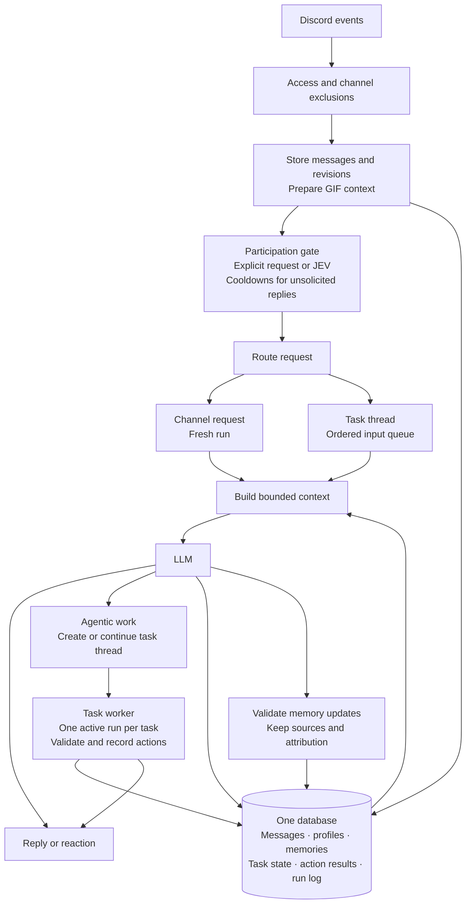

# Context, memory and tasks

Architecture target; the implementation status below identifies deferred parts. Uses UX.md and the current discussion. Supersedes SESSIONS.md where channel-session behavior differs.

## Comparison

| Question | Attached architecture | Our latest direction | Combined choice |
| --- | --- | --- | --- |
| Channel continuity | Conversation episodes group related messages | Fresh session per request | Fresh runs; reply links and optional topic summaries help select context |
| Old bot reply | Retrieve its episode and related tasks | Use the old message as context | Retrieve the message and supporting context; task changes route explicitly |
| Sustained work | Tasks can span episodes and threads | Persistent session in a dedicated thread | One primary task per bot-created task thread |
| Memory | Facts and decisions with sources and access scope | Messages, profiles, recall and task state | Keep those records separate in one database |
| Concurrency | Coordinate task and resource changes | Independent channel runs; ordered task inputs | One writer per task; version checks for shared resources |

The attached design adds useful separation between evidence, knowledge and execution. Its general episode resolver and many-to-many task relationships can wait. Our earlier SESSIONS.md resumes ordinary conversations on replies; the latest direction replaces that behavior with fresh channel runs.

## Flow



## Rules

- Channel requests use a fresh session. Include the current message, referenced message and relevant ancestors, selected recent chat, and relevant permitted memory. A topic summary is retrieval help, not a resumed session.
- Agentic work starts in its own thread. Its persistent session keeps a transcript plus structured goal, constraints, decisions, progress and artifacts. Unrelated ordinary Discord threads do not automatically become task sessions.
- A channel reply can inspect an existing task. An instruction to change it enters that task's queue instead of starting another executor. Ask when the intended task is ambiguous.
- Concurrent channel requests are independent. Task contributions stay attributed and ordered. Conflicting instructions require resolution; the latest message does not automatically win. Check pending corrections before external actions.
- Messages are evidence. Profiles and memories record attributed knowledge. Task state and action results record work. Suggestions remain proposals until accepted by the appropriate people.
- Enforce access scope before retrieval and before publication or action. Edits, deletions and exclusions invalidate affected indexes, summaries and memories. Excluded channels stop contributing immediately; purge their stored content and derivatives.
- Record action intent and results durably. Reconcile an unknown external result before retrying. Coordinate edits to shared resources even when their requests came from independent sessions.

## Prompt caching and reasoning history

Prompt caching is a design requirement. Each request has a stable prefix followed by changing context:

```text
Channel: fixed instructions + fixed tool definitions | selected context + request
Task:    fixed instructions + fixed tool definitions + existing history | new events
```

- Version the prefix. Keep its content, ordering and serialization stable. Put timestamps, requester details, retrieved memory and changing task state after the stable prefix. Use separate stable prefixes for different tool permissions or modes.
- Fresh channel sessions reuse the common prefix without inheriting another request's history. Persistent task sessions append messages, tool calls, tool results and provider-exposed reasoning items in their original order. Do not insert refreshed summaries or state before existing history.
- Persist every provider-exposed reasoning delta in an append-only run log, including interrupted or failed runs. Keep sequence numbers, run IDs and the original payload. Preserve opaque reasoning items intact when supplied. Only replay items supported by the provider; raw streamed deltas are not necessarily valid prompt messages.
- Context limits restrict what is sent, not what is retained. If compaction is needed, create a new checkpoint and prompt segment while retaining all original deltas and history. This starts a new cache prefix for that segment.
- Access restrictions and invalidated sources still govern replay. Retained run logs are restricted operational records, not general searchable memory. A previously cached prompt must not be reused if it would expose excluded or invalidated content.
- Measure cached input tokens, latency and cost. Cache availability depends on the chosen provider; stable prefixes enable reuse but do not guarantee a hit.

## Keep implementation small

Use one application, PostgreSQL, full-text search and pgvector. Search indexes point back to canonical records. Use a database-backed task queue with one worker initially. Enforce task ownership and resource version checks.

Add automatic topic grouping only if reply links, recent context and memory retrieval prove insufficient. Keep diagnostic context manifests available to admins. Preserve UX.md profile permissions, public profile access, configurable context limits and ordinary-response presentation.

Monitoring-off still permits explicit mentions, replies and registered task-thread continuation.

## Implemented now

SQLite stores canonical messages, vectors, checkpoints, durable jobs, tool operations and delivery intents. Fresh channel runs and persistent task threads share a stable instruction/tool prefix. Checkpoints retain original history and reasoning; source changes invalidate derived context. Token budgets use a conservative byte estimate through a replaceable counter. Provider usage records include cache hits when reported.

One worker owns the server queue, with ordered work per channel and concurrent work across channels. The shared tool registry validates permissions, journals operations, serializes writes by resource and stops uncertain retries. Slash commands and conversational actions invoke the same handlers. Tool writes run in dedicated threads with visible arguments and results.

Automatic GIF context for JEV, reactions and automatic topic grouping remain future work. SQLite scans vectors locally; deployed Postgres uses native pgvector distance with scope and model filters. Raw reasoning is retained, not replayed as ordinary chat text.

Profiles now provide server-public Discord identity, flexible attributed fields, edit locks and owner undo. Source changes invalidate custom fields. Relevant profiles enter prompts after the stable prefix. Cross-server profile sharing remains deferred.

On-demand file inspection uses the central tool registry, isolated format readers, and a separate vision prompt. Inspection runs retain all provider events and cannot complete the parent reply queue job.
