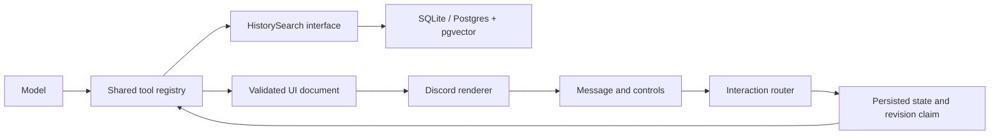

# Indexed history and Discord UI

The bot now exposes `history_search` and `history_read` through the shared registry. Automatic recall uses the same search backend. Postgres uses native full-text search and pgvector; SQLite uses FTS when available, keyword fallback otherwise, and cosine similarity. Hybrid retrieval combines ranked candidates with reciprocal-rank fusion and deduplicates message IDs.

Search supports authors, dates, channels, literal quotes, and opaque pagination cursors. Results carry original message links and indexing coverage. Author names resolve through profiles; ambiguous names require a mention. Every request and button click rechecks channel permissions. Search cursors belong to the requester, expire after an hour, and fix the initial upper date boundary. Ranking considers up to 200 candidates per method; pages can change after edits or deletions. No results is not proof an event never occurred.

`history_read` uses message timestamps, not insertion order, and includes nearby messages plus up to four reply ancestors. This handles backfilled history. Other-channel reply ancestors are excluded.

`conversation_summary` and `decision_lookup` generate reports from at most 40 indexed messages. They state the sampling limit, record source links, preserve model events including reasoning, and persist source fingerprints. Reading a saved report rejects changed or deleted evidence. Decisions are interpretations of the cited conversation; they are not automatically treated as confirmed memory.

## UI documents

The `ui_publish` tool accepts versioned JSON. Supported elements are text, cards, buttons, selects, and native polls. There is no evaluation of model-generated JavaScript, HTML, or SQL.

```json
{
  "version": 1,
  "type": "card",
  "title": "Search results",
  "text": "Found messages about deployment.",
  "actions": [
    {
      "label": "More results",
      "action": "history.next",
      "arguments": { "cursor": "cursor-returned-by-history_search" }
    }
  ]
}
```

Task tools supply their own UI documents; the model does not need to compose them manually. `history_search` returns text only. The model reads the results and writes the answer, and pages with the returned cursor. UI actions reference registered tools. Buttons carry opaque state IDs, revisions, and action indices. Arguments stay in the database. Clicks use the actual clicking member's identity and permissions, never an identity supplied by the model.



State is stored in `app_records`, within the configured database schema. Atomic revision claims prevent duplicate concurrent actions. Completed operation results repair UI state after a crash. Unknown action outcomes remain blocked rather than being repeated. Stale clicks refresh the message to its current controls. Controls expire after 24 hours. Task controls enforce task ownership.

Components V2 handles cards and selects. Native polls use a separate message because V2 disables polls. The renderer enforces component limits and suppresses multiple link previews. Poll questions, answer lengths and duration follow [Discord's poll limits](https://github.com/discord/discord-api-docs/blob/main/developers/resources/poll.mdx).

## Tasks and reminders

`task_manage` tracks goals, owners, progress, and outstanding questions. The creator, owner, or administrator can modify a task. It is separate from `task_start`, which starts ongoing agentic work in a thread. Quick task and reminder changes declare `execution: inline`; sustained write tools retain thread routing. Routing is tool metadata rather than a list hardcoded in the bot.

`reminder` creates, lists, and cancels personal channel reminders. Times must include a timezone. A persistent worker checks due reminders every 15 seconds, rechecks channel access, claims a delivery lease, and uses deterministic delivery IDs to reconcile restarts. Access failures retry after a minute. A reminder already being delivered cannot be cancelled. Reminders notify only their owner.

## Extend

- Add retrieval adapters through `HistorySearch`.
- Add UI actions in `src/ui/actions.ts`, pointing to registry tools with fixed arguments where needed.
- Add UI elements in `src/ui/schema.ts` and `src/adapters/discord-ui.ts`.
- UI execution and persistence belong to `src/ui/runtime.ts`.
- Add productivity tools under `src/productivity/`, registered at the Discord composition point.

## Local checks

Run `npm test`, then use `npm start` and test with slop-dev in an enabled channel:

1. Ask “search our history for deployment problems.” Ask for more results. The reply should page with the cursor and post no card.
2. Ask “read the messages around that result.” Verify timestamps, names, and source links.
3. Ask “summarize our deployment discussion” and “what did we decide about deployment?”
4. Ask “make a 24-hour poll: deploy today or tomorrow.”
5. Ask “track a task to verify deployment, owned by me.” Use **Complete**.
6. Ask for a reminder using an explicit ISO timestamp a few minutes ahead. Verify delivery; create another and cancel it.

For deterministic tool testing, use `/slopbot run tool:<name> arguments:<JSON>`. This reaches tools omitted from Discord's subcommand limit. Example: tool `poll_create`, arguments `{"question":"Deploy when?","answers":["Today","Tomorrow"],"hours":24}`.

The normal test suite skips external Postgres tests unless `TEST_DATABASE_URL` is set. Never point the full integration suite at bot data; its older contract test truncates tables. The new feature test creates and drops only its own temporary schema.
